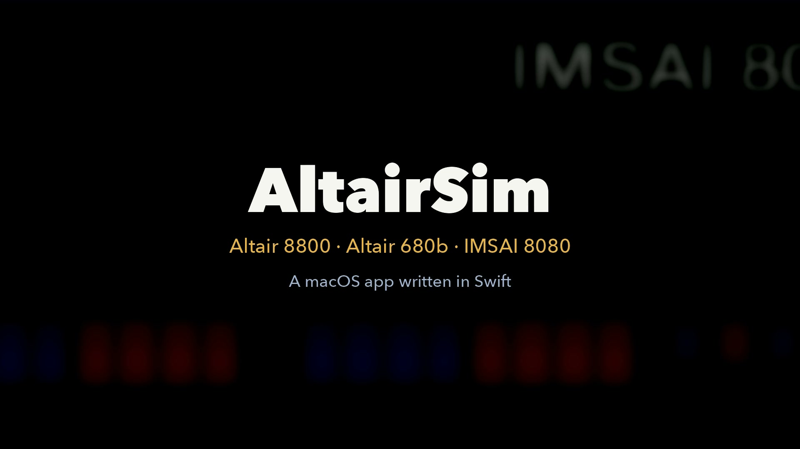

# Altair 8800 Simulator (Swift / macOS)

**English** | [日本語](README.ja.md) | [Website](https://masakai.github.io/AltairSim/)

A simulator of the Altair 8800 (1975), built around the Intel 8080.

[](docs/media/altairsim-en.mp4)

It runs the Altair 8800, the Altair 680b and the IMSAI 8080 with their front panels and a terminal (the video is 23 seconds long, with English narration; click the image to play it). A version with Japanese narration is on the [website](https://masakai.github.io/AltairSim/).

The app's menus and buttons are in Japanese. In this README, labels are given as they appear in the app, followed by an English translation.

## Running

```bash
swift run AltairSim   # launch the app
swift test            # tests for the CPUs, panels and loaders
```

### Using it as an app (.app)

```bash
Tools/make_app.sh              # build build/AltairSim.app (for this Mac's architecture only)
Tools/make_app.sh --universal  # Apple silicon and Intel
Tools/make_app.sh --install    # copy it to ~/Applications after building
```

This creates `build/AltairSim.app` (the Dock icon is drawn by `Tools/make_icon.py`). It is ad hoc signed, for use on your own Mac, and not notarized. To give it to other people, you need to sign it with a Developer ID and notarize it. The bundle ID can be changed with the environment variable `BUNDLE_ID` (default `local.altairsim`), and the version with `VERSION` (default 1.0).

ROMs and disk images are not included in the app, so on first use you import them from Settings (⌘,) (see "Importing ROMs and disk images" below). Imported files go to `~/Library/Application Support/AltairSim/library/`, which is shared with `swift run`.

## Layout

- `Sources/AltairCore`: 8080 CPU (every instruction, with clock counts), 64 KB of memory, a 2SIO-style serial port (ports 10h/11h), sense switches (port FFh), Intel HEX loader
- `Sources/AltairSim`: the SwiftUI front panel (A0–A15 switches, address/data LEDs, EXAMINE/DEPOSIT/RUN/STEP/RESET) and the terminal

## Usage

- 「デモを読み込む」 (load demo) → places HELLO / ECHO at 0000; run it with RUN/STOP
- Entering by hand: set the address switches and EXAMINE, then set the data and repeat DEPOSIT NEXT
- For BASIC and other programs, load your own image (`.bin` goes to 0000, `.hex` goes to the record addresses) with 「ファイルを読み込む」 (load file), then RESET → RUN

## IMSAI 8080

Choose 「IMSAI 8080」 in the machine selector to run the IMSAI 8080. The 8080 and the S-100 bus are the same as on the Altair 8800; the panel, the serial board and the floppy are different. The CPU and memory are shared with the Altair 8800.

- **Front panel (CP-A):** drawn from photos of the real machine and the CP-A manual. Top left: 8 programmed-output LEDs, 8 status-byte LEDs (MEMR, INP, M1, OUT, HLTA, STACK, WO, INTA), address LEDs A15–A8 and 8 paddles. Center: data bus LEDs, address LEDs A7–A0 and 8 paddles (which also serve as data switches). Right: the INTERRUPT ENABLED, RUN, WAIT and HOLD LEDs, and 6 control paddles (EXAMINE/EXAMINE NEXT, DEPOSIT/DEPOSIT NEXT, RESET/EXT CLR, RUN/STOP, SINGLE STEP, PWR ON/OFF). Each paddle does one thing on its upper half and another on its lower half, and they are colored blue and red.
- **I/O ports:** `02/03` and `04/05` are channels A and B of the SIO-2 (data/status, with the same bit layout as the 8251), `FD` is the FIF floppy, and `FF` is input = upper address switches (A8–A15) and output = programmed-output LEDs (lit when the bit is 0).
- **FIF floppy:** on the real IMSAI floppy interface, an 8080 on the board runs firmware (`fifware.asm`) that reads a 7-byte command string from memory and writes the result back to a status byte. This simulator does not run that firmware's 8080. It reproduces the behavior the host sees: checking the command string and the error codes C1–C6, A1–A3 and 93, reading, writing, formatting a track, and an approximation of the time each takes. Disks are IBM 3740 format (77 tracks × 26 sectors × 128 bytes = 256,256 bytes), the same as the 680b. The FIF cannot read an unformatted sector (93); a sector comes into existence when it is written or its track is formatted (function 3).
- **Booting:** the 「CP/M 1.31」 button inserts an IMSAI CP/M 1.31 disk in drive A, powers on, and reproduces the FIF boot (it reads the boot sector to address 0 and runs it). `DIR` lists PIP, STAT, ED, DDT, ASM and others, and `PIP COPY.COM=STAT.COM` writes to the disk.
- **New blank disks:** in the 「ディスク」 (Disk) menu, 「ドライブ X に新規の空ディスク(フォーマット済み)を作成…」 (create a new formatted blank disk in drive X) creates a formatted blank disk on the IMSAI (only the CP/M directory on track 2 is filled with E5; the rest is 0). This is because IMSAI CP/M 1.31 has no way to format a disk. The user guide (section 6.6, SYSGEN) assumes new disks are used without initializing them, and a test confirmed that running IMDOS's `FORMAT.COM` (IMSAI FORMATTER-INITIALIZER 2.05) on CP/M 1.31 stops with "INCOMPATIBLE VERSION OF SYSTEM / FORMAT ABORTED". With such a disk in drive B, `B:`, `DIR` (`NOT FOUND` = empty), `A:PIP B:STAT2.COM=A:STAT.COM`, `DIR` and `STAT2` were checked on screen.
- **Disk images:** the list in the Settings window has 10 disks for the IMSAI 8080, each with a link to where it comes from. CP/M 1.31 (16K) is from deramp.com; the others are `.tgz` files on a z80pack mirror ([icl1900.co.uk/unix4fun/z80pack/ftp/imsai/](https://www.icl1900.co.uk/unix4fun/z80pack/ftp/imsai/readme.txt)): CP/M 1.33 (52K, restored by Udo Munk), CP/M 2.2 (54K), Fig-Forth (on CP/M 2.2), IMDOS 2.02 (54K), IMDOS 2.05 rev.0 (54K, two disks), IMDOS 2.05 rev.1 (16K, the Maslin and Peters versions), and IMDOS's `FORMAT.COM`. A `.tgz` can be passed to 「ファイル・フォルダを取り込み…」 (import files/folders) without unpacking it: the app unpacks it into a temporary folder, identifies the `.dsk` files inside by name, and deletes the temporary folder after importing. The 「ほかの OS で起動」 (boot another OS) menu lists only the system disks you have imported.
- **Confirmed to boot:** CP/M 1.31 (16K), CP/M 1.33 (52K), CP/M 2.2 (54K), Fig-Forth, IMDOS 2.02, IMDOS 2.05 rev.0 and IMDOS 2.05 rev.1 (both versions) boot through the FIF boot and `DIR` works (automated test `testOtherIMSAISystemDisksBoot`; only CP/M 1.31 was also checked on screen in the app). UCSD p-System IV (`ucsd-iv.tgz`) produces no output after booting; the cause has not been investigated.

Checked on screen: booting ("IMSAI 16K CP/M VERS 1.31" and `A>`), `DIR`, and entering a program on the panel (address switches, EXAMINE, data switches, DEPOSIT, DEPOSIT NEXT, RUN, programmed-output LEDs, stopping at HLT). The automated tests (`IMSAITests`) cover booting, `DIR`, copying with `PIP`, `STAT`, FIF commands (unformatted sectors, formatting a track, writing and reading, error codes, write protect), port FF, the SIO-2, and EXAMINE and DEPOSIT.

Not yet confirmed: the INTA and HOLD LEDs on the IMSAI panel are always off (interrupt acknowledge and HOLD are not implemented). FIF error codes other than A1–A3 and C1–C6 (91, 92, 94–97) are not reproduced. IMDOS, IMSAI BASIC and the VIO (video) are out of scope. SIO-2 baud rate and mode settings are read and ignored.

## Importing ROMs and disk images

Because of their distributors' licenses, ROMs, disk images and 8080 test programs are **not included in this repository or in the app**. To use them, check each distributor's terms yourself, download the files, and import them into the app.

1. Open the menu 「AltairSim ▸ 設定…」 (Settings…, ⌘,)
2. Download each file from its 「取得元」 (source) link in the list (the list also shows the expected size of each item)
3. Choose several files or folders at once with 「ファイル・フォルダを取り込み…」 (import files/folders), or drag them onto the list. Items are identified by file name. A file with a different name can be imported with the item's own 「取り込み…」 (import…) button
4. Imported items get a green check mark

Imported files are copied to `~/Library/Application Support/AltairSim/library/` (the location can be changed with the environment variable `ALTAIR_LIBRARY`, which is meant for tests). If you press the button for a feature whose files are missing, the app shows the missing file names in the status bar and opens the Settings window. A file whose size differs from the expected size is still imported, with a warning. The list of where each file goes inside the library is in [docs/library.md](docs/library.md) (in Japanese).

### Where to get them

The exact source URL for each file is in the list in the Settings window (the 「取得元」 links) and in `catalog` in `Sources/AltairCore/AssetLibrary.swift`. The URLs are as of October 2026.

| Machine / use | Files | Where to look |
|---|---|---|
| Altair 8800 | Altair BASIC 8K ROM (`8kBas_e0/e8/f0/f8.bin`) | [altairclone.com/downloads/roms/8K BASIC/](https://altairclone.com/downloads/roms/8K%20BASIC/) |
| Altair 8800 | Disk boot loader (`88dskrom.bin`) | `roms/` in [github.com/tommojphillips/Altair8800](https://github.com/tommojphillips/Altair8800/tree/master/roms) |
| Altair 8800 | CP/M 2.2b, CP/M 3, Zork, BASIC Compiler, BDS C, FORTRAN-80, COBOL-80 | the folders under [altairclone.com/downloads/cpm/](https://altairclone.com/downloads/cpm/) |
| Altair 8800 | FORTRAN 2.8 for Altair DOS | [altairclone.com/downloads/altair_dos/](https://altairclone.com/downloads/altair_dos/) |
| 8080 instruction tests | `TST8080.COM` `8080PRE.COM` `CPUTEST.COM` `8080EXM.COM` | `cpu_tests/` in [github.com/superzazu/8080](https://github.com/superzazu/8080/tree/master/cpu_tests) |
| Altair 680b | PROM monitors (`MON680.S19`, `SWIMON.S19`), BASIC, boot PROM (`BOOT.S19`), FLEX 3.0, CP/68 | the folders under [deramp.com/downloads/altair/software/altair_680/](https://deramp.com/downloads/altair/software/altair_680/) |
| IMSAI 8080 | CP/M 1.31 (`imsai-cpm13.dsk`), IMDOS's `FORMAT.COM` | `IMSAI CPM/` and `IMDOS/` in [IMSAI software on deramp.com](https://deramp.com/downloads/mfe_archive/010-S100%20Computers%20and%20Boards/00-Imsai/40-Imsai%20Software/) |
| IMSAI 8080 | CP/M 1.33, CP/M 2.2, Fig-Forth, IMDOS 2.02 / 2.05 (`.tgz`) | z80pack mirror [icl1900.co.uk/unix4fun/z80pack/ftp/imsai/](https://www.icl1900.co.uk/unix4fun/z80pack/ftp/imsai/readme.txt) |

A list of the files distributed on altairclone.com is in [docs/altairclone-downloads.md](docs/altairclone-downloads.md) (in Japanese).

### Unformatted blank disks

In the 「ディスク」 (Disk) menu, 「ドライブ X に新規の空ディスク(未フォーマット)を作成…」 (create a new unformatted blank disk in drive X) asks where to save, creates a blank image (all bytes 0), and mounts it in that drive. Format it with the guest OS's formatting tool before use.

| Machine | Formatting tool | Reading it unformatted |
|---|---|---|
| 8800 (CP/M) | `AFORMAT B:` (on the CP/M 2.2 disk) | `Bdos Err On B: Bad Sector` |
| 680b (FLEX 3.0) | `NEWDISK 1` | disk error |
| 680b (CP/68) | `INIT 1` (answer `Y` to confirm) | `FORMAT ERROR` |

- The 680b (FD3712) records, for each sector, whether it has been formatted. Reading an unformatted sector is an error; writing it makes it exist. The record is saved next to the image as `<name>.dsk.fmt` (and deleted once every sector exists).
- The 8800 (88-DCDD) does not use this record, because CP/M's header check rejects raw sectors that have no header written.
- What was checked (all run on screen in the app, and also by the automated test `FormatToolsTests`):
  - 8800: `AFORMAT B:` finishes all 77 tracks, and copying with `PIP`, `DIR B:` and `STAT B:` (290k) work.
  - 680b FLEX: `CAT 1` on the unformatted disk shows that it cannot be read, and `NEWDISK 1` ends with "FORMATTING COMPLETE / TOTAL SECTORS = 988". After that, `CAT 1` shows `DISK: MYDISK #1` and `SECTORS LEFT = 988`, and `COPY` works.
  - 680b CP/68: `DIR 1` on the unformatted disk gives `DSK ERROR: 05`. After `INIT 1` (confirm with `Y` and Return), `DIR 1` shows `00000. SECTORS USED`, and `PIP` can copy to it.
- CP/68's `INIT` does not write the last sector of track 0, so one sector's worth of `.fmt` remains (this does not affect use). FLEX's `NEWDISK` writes every sector, so the `.fmt` file disappears.
- Following the MITS manual (Altair Floppy Disk 88-DCDD), the 88-DCDD reloads the head on a step, and a head unload right after write enable is held until the write finishes. The manual's timing rules (40 ms after head load, the 32 µs ENWD period, the automatic reset of the write current HCS, and so on) are not implemented, because the model has no notion of time.

### User items (adding files that are not in the list)

With 「ユーザー追加…」 (add user item) in the Settings window you can add ROMs, programs and disk images that are not in the list, with a name of your choice. Added files are copied to `library/user/files/` and appear in the 「ユーザー追加」 (user items) section of the list. The entries are saved in `library/user/items.json`, so they remain after a restart.

| Kind | Accepts | What you can do |
|---|---|---|
| Altair 8800 disk | `.dsk` of 337,568 bytes or more | 「起動」 (boot, from 88dskrom), 「装着」 (mount) in drives A–D |
| Altair 680b disk | `.dsk` of 256,256 bytes or more | 「起動」 (boot, from the same boot PROM as FLEX and CP/68), 「装着」 (mount) in a drive |
| Altair 8800 program/ROM | `.hex` (at each record's address), `.bin` (at an address you give) | Load into RAM or install as ROM, then run from the start address. RAM size is selectable from 4 to 64 KB |
| Altair 680b program/ROM | `.s19` | Starts the 680b monitor, loads the file into RAM, and runs it with J if it has a start address. With 「ROM として起動」 (boot as ROM) it starts from the RESET vector without the monitor |

The kind is chosen automatically from the file's extension and size, and can be changed when adding. For disks, 「作業コピーを破棄」 (discard working copy) returns the disk to its state when it was added. 「編集…」 (edit) changes the name or the start address. 「削除」 (delete) removes the entry and the copy inside the library (the original file is not deleted).

Each time a disk image is booted, a working copy is made in `~/Library/Application Support/AltairSim/disks/`, and writes go to that copy. The file in the library does not change.

### Building a CP/M disk (FORTRAN-80, COBOL-80 and others)

「CP/M ディスクをつくる…」 (build a CP/M disk) in the Settings window packs files into one CP/M 2.2 disk image for the Altair 8800. FORTRAN-80 and COBOL-80 are distributed as separate files, so this feature puts them on one disk.

1. Import the 「CP/M 言語系の単体ファイル」 (CP/M language files) items in the Settings list (their sources are in the 「取得元」 links)
2. Open 「CP/M ディスクをつくる…」 and press 「FORTRAN-80 一式」 (FORTRAN-80 set) or 「COBOL-80 一式」 (COBOL-80 set) (you can add your own files with 「ファイルを追加…」, add files)
3. Press 「つくる」 (build), and the disk is registered as one user item
4. Boot CP/M 2.2 (drive A), mount the user item in drive B, and switch to `B:` (for example `F80 =HELLO`, `L80 HELLO,HELLO/N/E`)

The source disk defaults to the imported CP/M 2.2b. If you turn off 「もとのディスクにあるファイルを残す」 (keep the files on the source disk), the files go onto an empty CP/M disk with all files removed (about 296 KB of space; the total size of the files to add is shown at the top right of the sheet). Tests confirm that the real CP/M 2.2b BIOS can read and write disks built this way (from track 6 on, the sector format and the order of sector numbers are different).

Tests that need library files are skipped automatically when the files are missing (`swift test`).

## ROMs

Where to get the ROM files (`8kBas_e0/e8/f0/f8.bin`, `88dskrom.bin`) is in the "Where to get them" table above.

The 「BASIC 8K」 button installs it at E000h and runs it (32 KB of RAM).
The BASIC ROM uses the serial port at ports 00h/01h (2SIO style), so the simulator connects both 00h/01h and 10h/11h to the same terminal.
`88dskrom.bin` is for booting from disk (FF00h) and is used to boot CP/M and Zork.

## Speed options

Switch them in the menus above the terminal.

- CPU: 「実機の速度」 (real speed: runs in step with real time and catches up when it falls behind; delays over 0.1 s are dropped) / 「最速」 (as fast as possible)
- Serial: 「制限なし」 (unlimited) / 9600 / 1200 / 300 / 110 baud (Teletype, 11 bits per character).
  The transmit-ready bit (bit 1 of the status) goes low for the time one character takes, so programs that check the status before output, such as BASIC, slow down

## Disks and CP/M

- An 88-DCDD floppy disk controller (ports 08h–0Ah, drives A–P) is implemented. Rotational delay is not modeled in time; it is a simple model where "each read of the sector register advances one sector"
- Disk images are `.dsk` files of 77 tracks × 32 sectors × 137 bytes (337,568 bytes) or more. Distributed `.dsk` files have padding at the end (CP/M 2.2 is 337,664 bytes)
- 「CP/M 2.2 で起動」 (boot CP/M 2.2): puts a working copy of `disks/cpm22b23-56k.dsk` from the library (available from altairclone.com) in `~/Library/Application Support/AltairSim/disks/`, mounts it in drive A, and boots from 88dskrom (FF00h). RAM is 64 KB. Writes to the disk go to the working copy; the original file does not change
- From the 「ディスク」 (Disk) menu you can mount and unmount any `.dsk` in drives A–D. In that case writes go directly to the file you chose
- 「CP/M 3 で起動」 (boot CP/M 3): mounts `cpm3_v1.0_56K_disk1.dsk` from the library in drive A and `cpm3_v1.0_56k_disk2.dsk` in drive B, and boots. Working copies are handled the same way as for CP/M 2.2
- Checked: booting CP/M 2.2b, `DIR`, copying files with `PIP` (writing to disk), and `PRINT 2+3` in `MBASIC` (BASIC-80)

## Disk drive view

Drives A and B of the 88-DCDD are drawn below the panel (colored after photos of the blue cabinet stacked under an Altair 8800). Clicking a door switches between inserting a disk (choosing a file) and ejecting it. While a disk is in, the slot shows a sleeve and the file name; the IN USE lamp shows access, and TRK shows the head position.

CP/M 3 checks: boots from `CP/M V3.0 Loader` through `CP/M 3 BIOS v1.0 for Altair 8" Floppy`, `DIR`, writing to drive B with `PIP`, and `PRINT 2+3` in `MBASIC` (BASIC-80 Rev. 5.21).

## Zork

The 「Zork」 button boots a Burcon 56K CP/M 2.2 disk (`zork.dsk`) from drive A. At `A>`, type `ZORK1` or `ZORK2`. The disk has `ZORK3.COM` but not its data file, so it stops at `Load Game Disk`.

## 8080 instruction tests

CP/M test programs imported into `cpu_tests/` in the library are run in a harness that emulates only the BDOS call (0005h) (`CPUExerciserTests`).

| Test | Result |
|---|---|
| `TST8080.COM` | `CPU IS OPERATIONAL` |
| `8080PRE.COM` | `8080 Preliminary tests complete` |
| `CPUTEST.COM` (SuperSoft Diagnostic II) | `CPU TESTS OK` (255,651,553 clocks = about 128 seconds at 2 MHz; the distributor's description says "about 2 minutes at 2 MHz") |
| `8080EXM.COM` (checks every instruction and flag by CRC) | all 25 items `PASS` (23,803,378,391 clocks = about 3.3 hours at 2 MHz; about 318 seconds in a release build) |

8080EXM takes a long time, so it runs only when an environment variable is set.

```bash
RUN_8080EXM=1 swift test -c release -Xswiftc -enable-testing --filter CPUExerciserTests/test8080EXM
```

## How HLT behaves

It follows the Intel 8080 data sheet (pages 2-13 to 2-14, Table 2-1).

- Executing HLT enters the halted state (HLTA): the RUN switch stays at RUN, HLTA lights and WAIT goes out. The address LEDs show the address after the HLT, and the status is HLTA + MEMR + WO (M1 off)
- The only ways out are RESET (PC = 0) and an interrupt while INTE is 1. STOP → RUN and SINGLE STEP do not release it
- HLT after DI can only be left with RESET
- The real panel has no switch that raises an interrupt, so it is exposed as an internal function (`AltairMachine.requestInterrupt`) for tests. HOLD is not implemented
- The data LEDs keep the value of the HLT instruction (76h). On the real machine the data bus floats partway through the M2 cycle, so how the panel looks there has not been confirmed

## Delete key

What the terminal's delete key sends depends on the program being run (it can also be changed with the terminal's 「削除キー」 (delete key) setting).

| Setting | Code | Used for |
|---|---|---|
| BS (^H) | 08h | CP/M (default). Erases the character on screen with BS-SP-BS |
| DEL (7F) | 7Fh | CP/M echoes the deleted character as is (meant for hard-copy terminals). Altair BASIC shows it like `\9\` |
| _ (Altair BASIC) | 5Fh | Altair BASIC (chosen automatically when 「BASIC 8K」 starts). BASIC deletes the character and shows `_` |

The Mac's delete key does not match SwiftUI's `.delete` and arrives as the character U+007F, so it is detected by character. fn + delete (forward delete) sends 7Fh, which corresponds to the ADM-3A's RUB OUT.

## Hex input

There are two input fields below the toolbar.

- Switches: sets the address switches (A15–A0) in hex (for example `FF00`). When you move the switches by hand, the field follows
- Write: writes to RAM in the form `address: bytes` (for example `0000: 3E 01 76`). It follows the same steps as EXAMINE → DEPOSIT → DEPOSIT NEXT … on the panel, and after writing, the start address is left EXAMINEd. While running, it STOPs before writing. Addresses that are not RAM (ROM or unpopulated areas) are not written

## Terminal (80 columns × 24 lines)

The terminal has an 80 × 24 screen buffer and understands the following controls.

- Control characters: CR, LF (scrolls at the bottom line), BS (only moves the cursor back; the character is not erased; CP/M's BS-SP-BS erases it), TAB. DEL (7Fh) and others are ignored
- ANSI (VT100 family): `ESC [ H` `f` (cursor position), `A B C D` (cursor movement), `J` (erase screen), `K` (erase line), `L M` (insert/delete line). `m` (character attributes) is ignored
- ADM-3A: `ESC = row column` (cursor position), 1Eh (home), 1Ah (clear screen)

This was needed because WM (WORDMASTER, a screen editor on the CP/M 2.2 disk) controls the screen with ANSI sequences.

## Altair 680b (Motorola 6800)

Switch between the Altair 8800 and the Altair 680b with 「機種」 (machine) at the top left of the window. The terminal (ADM-3A style) is shared.

- CPU: MC6800 (`CPU6800`). Every instruction, IRQ, NMI, SWI and WAI, with clock counts. Undefined opcodes are counted as 2-clock NOPs (`illegalCount`)
- Clock: 500 kHz
- Memory: 8 KB of RAM, an ACIA (6850) at F000 (control/status) and F001 (data), straps at F002, and the PROM monitor at FF00–FFFF (the 680b's MON680.S19)
- Panel: the AC / HLT / RUN LEDs, address LEDs (A15–A0), data LEDs (D7–D0), the switches, RESET, HLT-RUN and DEP. There is no EXAMINE; while halted, the contents of the address on the address switches appear on the data LEDs
- 「モニタ起動」 (start monitor): the "." prompt appears. `M 0010` displays and writes memory, `N` goes to the next address, `J 0020` runs, `L` loads S-records
- 「BASIC を読み込んで起動」 (load and start BASIC): loads the paper-tape BASIC with the monitor's `L` command and starts it with `J 0000`. Press Return for `MEMORY SIZE?` and `TERMINAL WIDTH?`, and answer N to `WANT SIN-COS-TAN-ATN?`
- 「端末なし(フロントパネル運用)」 (no terminal, front-panel operation): sets the straps to "no terminal" and runs from address 0000 after reset. This is the setup for running a program entered with the switches

Checked: the monitor, loading and starting BASIC, `PRINT 6*7` (42), a FOR loop, `PRINT 100/7` (14.2857).

Clock: 500 kHz (2 microseconds per clock), confirmed in the 680b Theory of Operation (a 2 MHz crystal divided by 4). Not yet confirmed: the differences between the 680 and the 680b, details of the panel's colors and layout, and a standard CPU test (none found).

## 6800 functional test program

`Tools/gen6800_functional_test.py` generates a 6800 machine-code program that executes every MC6800 opcode (196, excluding WAI) in every addressing mode and checks the results.

- One case = one instruction and its inputs (the contents of A, B, X, CC, memory and the stack). 2,660 cases (12 per instruction; DAA has 320, covering the kinds of upper and lower nibble and every combination of H and C)
- Before each case, the program sets the registers and CC all at once with RTI (so the flags are not disturbed). After executing, it gathers A, B, X, SP, CC, 4 bytes of memory and 16 bytes of stack, and compares a 16-bit checksum with the expected value. For mismatching cases, it records the position and the actual state of up to the first 32
- The expected values are computed by a reference model (Python) in the same file. It describes each instruction by "the definition of integer arithmetic" (V when the signed range is exceeded, C on an unsigned borrow), which is a different way of writing it from the CPU implementation (bit operations)
- Output: `Tests/Resources/6800/functional6800.s19` (program and data), `functional6800.txt` (each case and its expected state), `functional6800.json`
- Run: `CPU6800FunctionalTests` (about 11.5 million clocks). To regenerate, run `python3 Tools/gen6800_functional_test.py`

Confirmed: the CPU matches in every case. Ten kinds of bugs were planted in the CPU (V of ROL, DAA, H of ADD, C of SBC, the stack order of JSR, V of CPX, Z of INX, BGT, I of TAP, C of NEG), and all of them were detected.

Limits: the reference model and the CPU were written by the same person (me), so a misunderstanding shared by both cannot be found. Nothing was compared against real hardware or another emulator (the program itself is 6800 machine code, so it can be run elsewhere). Invalid BCD input to DAA, the "undefined" handling of V (DAA masks V), and WAI and interrupts are out of scope.

## Altair 680b disks (68-UIO and FD3712)

- The 680b, like the 8800, has a disk controller and a view of drives A–D (two drives per cabinet × 2 stacked). The mount/unmount mechanism (`DiskSubsystem`) and the drive drawing are shared
- 68-UIO board: a second ACIA at F006/F007 (no terminal attached), and two MC6821 PIAs at F008–F00F (`PIA6821`). The PIA registers are wired with the lowest address bit inverted (F008 = control A, F009 = data A, F00A = control B, F00B = data B)
- Pertec FD3712 (`FD3712Controller`): port A of PIA #1 is the status/data input (inverted logic), port B is the command output, and port B of PIA #2 is the data output. The execute strobe is the OR of the handshake between CB2 on the data-output side and CA2 on the data-input side (the PIA's automatic handshake). Commands: reset (81), set drive/sector (21), set track (11), seek (09), return to track 0 (0D), read (03), write (05), verify CRC (07), write buffer (31), read buffer (41), clear error (0B)
- Disks are IBM 3740 format (77 tracks × 26 sectors × 128 bytes = 256,256 bytes). There is no rotational position; each command is approximated by the time it takes (busy)
- Checked: a test (`FD3712Tests`) that copies into Swift the register operations used by the FLEX boot PROM (BOOT.ASM) and disk driver (DSKDRV.ASM) confirms reading, seeking, writing, two drives, an unconnected drive, write protect and busy time

Right after the app starts, both the 8800 and the 680b are powered off (all lamps out). Each machine has its own power, so switching machine tabs leaves the other machine's power and terminal screen as they were. Start the 8800 with the POWER switch on the panel or with a boot button such as 「CP/M 2.2」. After the POWER switch, you operate the RUN switch yourself, as on the real machine. The boot buttons (「BASIC 8K」, 「CP/M 2.2」, 「CP/M 3」, 「Zork」) power on and run from the boot address. When the 680b is powered on, the PROM monitor starts and shows the "." prompt.

- Checked with the real boot PROM and the distributed disk images: 「FLEX 3.0」 boots `6800 FLEX V3.0`, asks `DATE (MM,DD,YY)?`, and `CAT` lists the files (SAVE, PCGET, …, BASIC, CC, WC and others, 493 sectors left). 「CP/68」 boots `HEMENWAY ASSOCIATES CP/68-1.0`, and `DIR` lists INIT, LINK, PIP, CP68.SYS and others. On FLEX, the `BASIC.CMD` on the disk (59 sectors) also runs (typing `BASIC` gives `READY`, `PRINT 2+3` gives 5, and a FOR loop gives `1  4  9  16  25`). In FLEX BASIC, `SAVE "SQUARES"` saves to disk, and after `NEW`, `LOAD "SQUARES"` reads it back (`SQUARES.BAS` appears in the FLEX directory). Disk writes are written back automatically to the working copy (`~/Library/Application Support/AltairSim/disks/`) about 1.5 seconds after disk activity stops, so they remain after the app is closed. On CP/68, `PIP COPY1.SYS=CP68.SYS` confirmed writing to disk, and the written file could be read back with `COPY2.SYS=COPY1.SYS` (once started, PIP stays at its `PIP-` prompt; how to leave it is not documented and has not been confirmed). Tests confirm that a SAVEd file remains in `CAT` and can be `LOAD`ed after rebooting on another machine instance. The FD3712 wait times (about 6.4 ms for a read or write, 1 ms per track for a seek) are approximations from the data sheet and have not been compared with measurements on real hardware. On the real 680b the power switch is on the back panel (Operator's Manual p.14), so it is not on the front panel; it is switched with 「電源(背面)」 (power, rear) in the button column on the left of the window. OFF turns off all lamps and stops the CPU; ON lights the AC lamp and starts the PROM monitor. Both use the boot PROM (`altair680/boot/BOOT.S19`), SWIMON, the 68-UIO, 48 KB of RAM and the disk in drive A, and boot with the monitor's `J FC00`
- In the distributed FLEX 3.0 image, the boot loader (bytes 5 and 6 of physical sector 1 on track 0) does not contain the location of the system file (FLEX3.SYS) (the state before LINK.CMD is run). As is, the loader tries to read track 0 sector 0 and keeps restarting the boot. The 「FLEX 3.0」 button does the same thing as LINK on the working copy (`FLEXImage.linkBootLoader`, which finds FLEX3.SYS at track 17, sector 12 in the directory and writes it) before booting. The original image is not changed
- Drive labels and the handling of working copies (`~/Library/Application Support/AltairSim/disks/`) are the same as for the 8800 disks

## License

The source code and documentation in this repository are under the [MIT License](LICENSE). Files you import and use, such as ROMs, disk images and 8080 test programs, are not covered; each follows its distributor's terms.
